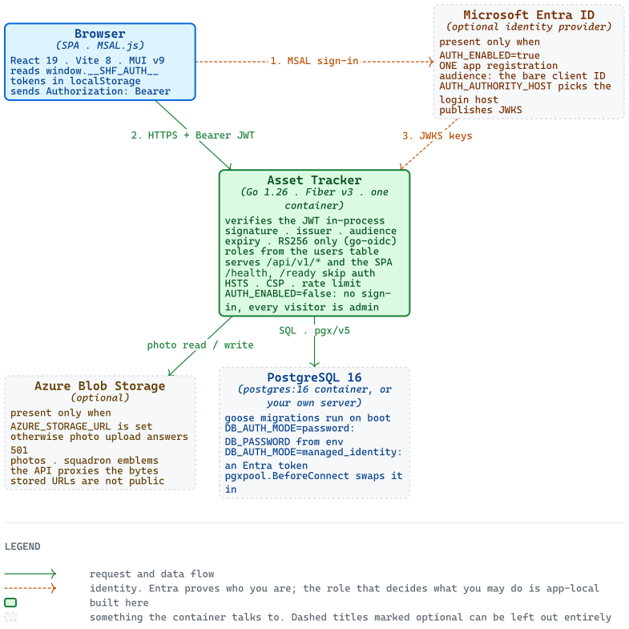
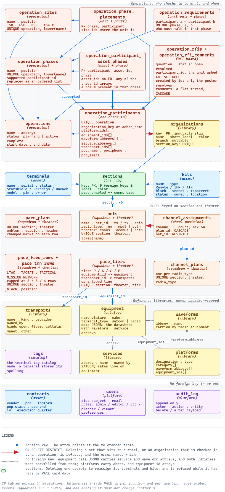
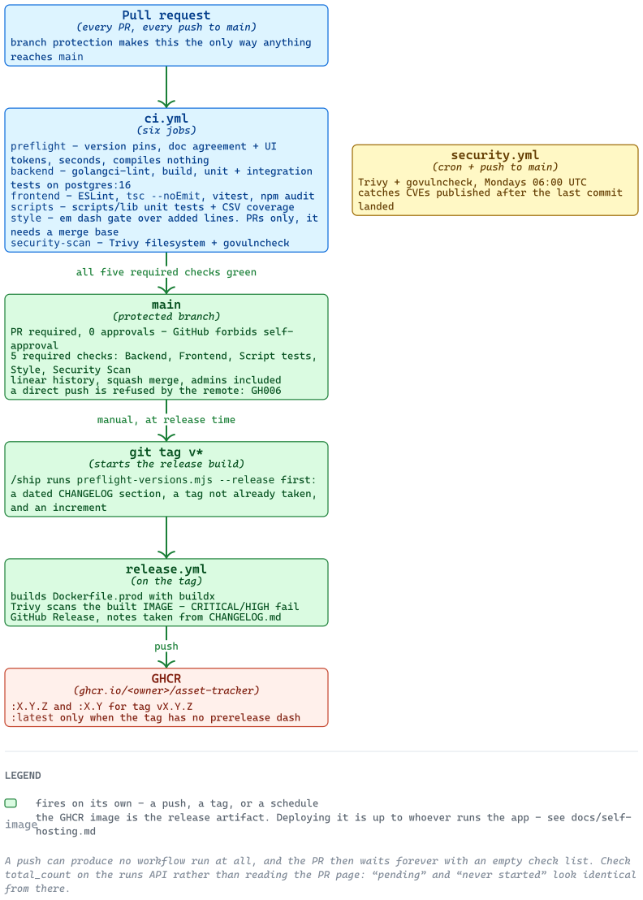

# Asset Tracker

> **New here?** Read [`START_HERE.md`](START_HERE.md) first. It gets the app running in about fifteen minutes
> with nothing but Podman or Docker, and tells an AI assistant what to read before it changes anything.

Tracks terminals, kits, contracts and field equipment across squads and sections, and plans the comms that run on them. An Equipment Catalog holds SATCOM and radio data sheets, which draw on global waveform, services, transport and platform libraries; a joint compatibility matrix reads every waveform against every asset, ours and theirs; a per-squadron nets library feeds a PACE comms card built to print; and Operations plans who joins an operation, what each unit brings, where it sits in each phase and whether it can talk to the units it must. Editors keep the inventory accurate (status, owner, kit, serial, notes); admins manage roles, sections, and review the audit log; everyone authenticated can read and export.

Built on **Go + Fiber** (backend), **React + Vite** (SPA) and **PostgreSQL**. A single container hosts both the API and the built frontend. Sign-in is optional: with `AUTH_ENABLED=true` the Go process validates Microsoft Entra ID tokens in-process via `coreos/go-oidc` and the SPA acquires them through MSAL.js; with `AUTH_ENABLED=false` there is no identity provider at all, which is how the dev stack and the self-hosted stack run.

<picture>
  <source media="(prefers-color-scheme: dark)" srcset="./diagrams/system-architecture-dark.svg">
  
</picture>

## Documentation

| Start here if you want to... | Read |
|---|---|
| Know what the app is for and who uses it | [`docs/product.md`](docs/product.md) |
| Understand a domain word (ALERT, IFK, PACE...) | [`docs/glossary.md`](docs/glossary.md) |
| See every component in the stack and what it does | [`docs/stack.md`](docs/stack.md) |
| Run it locally | [`docs/development.md`](docs/development.md) |
| Run it on your own machine, no cloud account | [`docs/self-hosting.md`](docs/self-hosting.md) |
| See a worked example operation | [`docs/demo-operation.md`](docs/demo-operation.md) |
| Change it, as a person or an agent | [`AGENTS.md`](AGENTS.md), then [`.claude/context/project.md`](.claude/context/project.md) |

## Features

### Inventory

#### Dashboard

- The home page for every role (`/dashboard`): `/` redirects here, and the Signal Suite mark at the top right of the header links back to it from anywhere.
- One tile for each page in the header picker that the signed-in role can open, in the picker's order, with the picker's icon and the page title under it.
- What shows depends on the role: only admin and editor see Terminals, Kits and Contracts, and only admin sees Users.

#### Stats

- A read-only overview of the fleet in the header picker (`/stats`), for every role.
- Terminal tiles break down by family (Starshield / Paradigm / OneWeb), with per-model subtotals.
- Terminals and kits carry the same status row (Available / ALERT / On Mission / Reserved / INOP), using identical buckets and colours, so the two read against each other at a glance.
- Section and kit-type breakdowns sit beneath.
- Every tile is a link into the matching filtered list, so the Stats page is a navigation surface rather than a report.

#### Terminals

- List, search, paginate, inline-edit, side-drawer detail and free-form section grouping.
- Model classification across three families:
  - **Starshield**: Mini / HP
  - **Paradigm**: Hornet / Ragno, each with a dedicated PIM # field
  - **OneWeb**: OW-7 / OW-10 / OW-11
- The sidebar shows collapsible family groups with model deep-links.
- The in-page variant filter is multi-select with server-side filtering, so totals and pagination reflect the filtered results.
- Terminals, Kits and By Section are navigation-hidden for every role except `admin` and `editor` (`canSeeTrackers`); the reads stay open by URL.

#### Kits

- A top-level asset domain parallel to Terminals: list, search, paginate, inline-edit, side-drawer detail and section grouping.
- Classified by **type** (Remote / IFK / ATK), with sidebar deep-links and a multi-select in-page filter.
- Three independent network flags, **BLACK / SECRET / TS**, shown as check columns and drawer checkboxes.
- Assigned-to owner fields, location, and a status stat strip.
- Full CSV import, export and template.
- Migration `022_create_kits.sql`.

#### Contracts

- Track contracts by POP dates, vendor, POC, execution quarter, fiscal year, and Logform # (a clickable hyperlink column).
- Inline editing per cell, deadline colour-coding (red / orange / yellow), and sortable columns.
- FY-based sidebar navigation.

#### Sections

- **Management**: admins and editors create, rename, recolour and delete sections.
  - A delete prompts for safe reassignment of both terminals and kits.
  - It is refused outright while the squadron still has nets or a saved PACE card, which are never moved to another section.
- **PACE squadron toggle** (`sections.pace_enabled`, migration `036_add_section_pace_enabled.sql`) decides which sections get a JEM/MPU5 comms card and their own Nets library, so adding one is a setting rather than a deploy.
- **Drill-down**: sidebar section links filter whichever list you are on, and a Terminals ⇄ Kits switch in each toolbar shows both counts for the active section and carries the filter across. The sidebar section links and that switch are visible to `admin` and `editor` only.

#### Tags

- One case-insensitive grouping label per terminal, spanning sections.
- The catalog is populated by terminal saves as well as from Settings, so every tag in the system is listed there with a usage count.
- The drawer offers the catalog as an autocomplete while still accepting a brand-new tag.

### Equipment Catalog and Comms Library

#### Equipment Catalog

- A browse grid of SATCOM and radio terminal data sheets, with search and a type filter.
- **A facet sidebar** narrows the catalog the way a shopping site does:
  - multi-select values with live counts: bands, manufacturer, operational mode, waveforms, services
  - numeric ranges with preset cuts plus a custom threshold: weight (normalised across lbs, oz and lbs-oz), transmit power, range in mi or km
  - counts exclude their own facet, so checking one band never falsely reports the others as empty
  - a record with the field left blank is excluded from a range but surfaced as a counted **Not specified** toggle, rather than vanishing
  - filters live in the URL, so a narrowed catalog is a link
- **A full data sheet per item** (specs, frequencies, features, compatibility matrix), with a print route at `/catalog/:id/print`.
  - It also exports to a `.png`, the clipboard or a single-slide `.pptx`, captured from the same page box the print CSS produces, so the slide cannot drift from the printout and honours the scale slider.
- **A 3-pane editor** (list / form / live preview) for admins and editors.
  - Photo upload and removal through Azure Blob Storage, with a managed identity and no SAS tokens.
- SATCOM services carry CIR/MIR rates, or a **Best Effort** flag for services sold without a committed rate.
- Migrations `017_create_equipment.sql` and `018_create_waveforms.sql`.

#### Comms Library

- The four shared reference tables (waveforms, SATCOM services, transports and platforms) browse at `/catalog/comms-library`; the organizations that join an operation are picked inside Operations and managed on the Settings page.
- Read-only for everyone, and editable by the roles that own each one.
- Named Comms Library rather than RF Library because transports include fibre circuits, which are not radio at all.
- Any of the four prints from a read-only route (`/catalog/comms-library/print`) with the add form and row pencils dropped, and shares to a `.png`, the clipboard or a `.pptx` from the same menu the data sheet uses.

#### Compare

- A comparison view at `/catalog/compare` puts any number of records side by side on any subset of parameters, SATCOM and radio together.
- It distinguishes a spec a record simply lacks from one that does not apply to its type.
- It prints as a balanced, page-repeating table at `/catalog/compare/print`, with a Paper (ink-on-white, for a printer) or Dark (screen-matched, for a shared PDF) palette.
- A **Fit to one page** toggle shrinks the printed comparison on both axes, columns and rows together, down to 70%, and the live page reports the resulting page count beside it.
- Its PNG, clipboard and PowerPoint export stays dark regardless of the print palette chosen.

#### Waveform Library

- A centrally managed waveform reference table (`waveforms`).
- Editors define each waveform once (abbrev, name and description); radio equipment records link to them through toggle chips in the Section 03 editor panel.
- Supports the compatibility matrix between radio types.
- Browsed and edited in the **Comms Library**, where each row counts the assets carrying it and names them, or reads **unused**: the case the facet rail cannot show, since its values come from the equipment pool rather than the library.
- Deleting a waveform that a catalog radio or a platform still carries is refused with a 409 naming them.
- Renaming an abbrev carries the new spelling onto every record that used the old one.

#### Services Library

- The SATCOM twin of the waveform library (`services`).
- Editors define each service once: abbrev, name, description, and who owns the operator and in which country.
- SATCOM equipment records link to them through toggle chips in the Section 03 editor panel.
- CIR, MIR and the Best Effort flag stay on the equipment record, because two terminals on the same service carry different committed rates.
  - The chips choose which services a terminal offers; the rows beneath them carry the rates and the datasheet ordering.
- Browsed and edited in the **Comms Library**, like waveforms and transports, and each row counts and names the terminals offering it.
- Unlike waveforms, writing is limited to admin and editor; `rto` is the radio side of the split.
- Migration `026_create_services.sql`, which also backfills the library from every abbrev already typed into `equipment.data.services`; ownership is `043_add_library_owner.sql`.

#### Transport Library

- The third global reference table (`transports`), for the paths a PACE tier names when it is not a SATCOM terminal: a fibre circuit, a cellular plan, a MANET mesh, or whatever else a squadron actually runs.
- Each entry carries a name, a kind, a provider, who owns that provider and in which country, and a description.
- Browsed and edited in the **Comms Library**, beside the waveform and services libraries.
  - That route is why this table is readable at all: transports have no browse tab of their own, so until it existed the only way to see one was to hold a write role and open the catalog editor.
- **Kind is an open vocabulary.**
  - Four defaults (fiber, cellular, manet, other) are offered, and anything already in use joins the list, so a squadron picks `+ Add new kind…` rather than filing an unanticipated path under "other".
  - Kinds are normalised to lowercase, so the list cannot fill with one kind spelled three ways.
- The unique index is case-insensitive on `name`, because a transport has no abbrev to key on.
- Writable by admin, editor, `rto` and `planner`: the same writers as nets, PACE and platforms.
- Migrations `033_create_transports.sql` and `043_add_library_owner.sql`.

#### Platform Library and joint compatibility matrix

- The fourth global reference table (`platforms`) holds external comms platforms (an F-35, a DDG, a ground station) that are not equipment we own.
  - Each has a designation, popular name, category and type.
- **Category is the branch or branches operating the platform**, from a closed list: USA, USMC, USN, USAF, USSF, USCG, and OGA for an agency inside the government but outside the military.
  - Shown as one coloured chip per branch; an airframe flown by three services is one row with three chips.
- **Type is a fixed list**: aircraft, UAV, ship, ground vehicle, ground station. A UAV is kept apart from aircraft because nobody talks to it from inside it.
- The library filters by category and type; each platform's carried waveforms and radios show as tiles on its row, and which platforms share a waveform is the matrix's job.
- A platform lists the waveforms it carries directly, the catalog radios it carries, or both, in the **Comms Library** (`?lib=platforms`), writable by PACE's writers.
- **The matrix** at `/catalog/compatibility` puts every waveform against every platform and every catalog radio.
  - Filtered by branch and type in its Filters panel, with a column picker grouped by branch, all held in the URL, so any set of assets can be read side by side: the input to a PACE across a joint force.
  - It is **live**: a carried radio's waveforms are read from its catalog record at render, so editing the radio moves the matrix, where the per-radio matrix on a data sheet deliberately snapshots.
  - Prints landscape at `/catalog/compatibility/print` the way the compare page does: a wide selection continues on further pages across with the waveform labels repeated, a tall one on further pages down with the header repeated, the page says how many pages it will take, and Fit to one page shrinks the sheet onto one page when it can.
  - Exports to a `.pptx`, the clipboard or a `.png` from the same share menu as the compare page.
- Migrations `040_create_platforms.sql`; `044_platform_category_branches.sql`, which turned the old free-text operator into the branch list and retired the organic / joint category; and `045_platform_type.sql`, which made the type a fixed list.

#### Organization Library

- A reference table (`organizations`) holds the organizations that can take part in an operation: a service component, a squadron, a coalition partner, an agency.
  - Each has a key, a name, a short label for its badge, an optional branch from the same closed list platforms use, a colour, an optional link to one of the app's own sections, and notes.
- **The key is a lowercase slug that never changes**, because an operation's participant rows point at it; names are unique regardless of case.
- The list is the enterprise's members, entered once; nine colour-named placeholders are seeded so the library is never empty.
- An organization that is checked in to an operation cannot be deleted, and the refusal names the operations.
- **Picked only inside Operations**: the Join Operation wizard lists the organizations and its Add to library creates one, writable by PACE's writers. There is no Comms Library chip for them and no row in the `+` menu.
- **Managed in Settings**: the Organizations tab lists every organization with how many operations use it, and adds, edits and deletes them for the same writers. Delete is off while an operation has the organization joined.
- **CSV export, import and template** cover the library, from the header's share button like every other dataset, for the same writers.
  - The key is a column of its own and is the identity: import only adds organizations, and a row whose key already exists is skipped as a duplicate rather than overwriting an organization that operations point at.
  - A name already taken, a branch that is not one of the seven, or a section that does not exist or is already linked by another organization fails that row alone, and the rest of the file still lands.
- Migration `046_create_organizations.sql`.

### PACE and nets

#### PACE Planner

- A per-squadron comms card combining two radio wheels (JEM and MPU5), with a Primary / Alternate / Contingency / Emergency service plan, destined for a single landscape printout.
  - 16 channels per wheel by default, sizable from 1 to 64.
- **Every squadron keeps two whole cards, CONUS and OCONUS**, switched by one control in the card's banner and carried into Edit, Print and the exports through `?theater=oconus`.
  - The same switch sits on the Nets Library, and a card may only assign nets from its own theater.
- Wheels render as a numbered dial with net labels stacked outside the ring and joined by leader lines, so every position stays legible at print size; the squadron emblem sits in the hub.
- A sidebar group with a sub-item per card-bearing squadron.
- **A card editor** at `/pace/:section/edit` writes the whole card in one save.
  - A radio omitted from the payload is left untouched; a radio sent with no channels clears that wheel.
  - Assigning a net is validated server-side against the squadron that owns it and the radio that carries it.
- The sheet's middle band carries free-form LTAC and TACSAT frequency tables and a TACTICAL MISSION NETWORK box, capped at 8, 8 and 6 rows so the PACE tiles stay on the page.
- The four PACE tiles are filled from the Equipment Catalog, the Transport Library, or a typed line, with the terminal photo and its CIR/MIR rates resolved server-side so the printed sheet renders from one payload.
- Exports to a `.png`, the clipboard or a landscape `.pptx` slide whose text is **native and editable in PowerPoint** rather than flattened into the picture, with the card's own fonts embedded so it renders correctly on a machine that does not have them.
- **Changed marks**: every field in the editor carries a tick, and a ticked value prints red on the card, the print sheet and both exports, so whoever a revised card is handed to can see what moved.
  - An optional version label (`v2`) prints after the date, and "Clear all marks" starts the next revision.
  - The marks are set by hand, not computed by comparing saves.
- Migrations `025_create_channel_plans.sql`, `027_create_pace_plans.sql`, `031_add_pace_emblem.sql`, `032_create_pace_sheet_rows.sql`, `034_create_pace_tiers.sql`, `035_add_freq_row_channel.sql`, `041_add_pace_highlights.sql` and `042_add_theater.sql`.

#### Nets Library

- A **per-squadron** reference table of radio nets (`nets`) feeding the PACE wheels.
  - Name, channel number, TX/RX frequencies, MHz/GHz unit, and a **ROIP** flag for nets carried over IP rather than RF alone.
  - TX/RX are freeform, because a net is recorded as a range or a placeholder as readily as a single figure.
- Split into **JEM / MPU5** tabs by a `radio_type` of `jem`, `mpu5` or `both`, so a shared net appears under each tab rather than being entered twice.
- Split into **CONUS / OCONUS** lists by a `theater` of the same shape, so a net used in both theaters is likewise entered once.
- A name is unique among the nets one theater's list shows.
  - Uniqueness is per squadron, not global: several squadrons commonly run a FIRES, and one editing it must not change another's.
- Deleting a net that sits on a wheel is refused with a message naming the wheels.
- The open radio tab prints read-only at `/nets/:section/print` and shares to a `.png`, the clipboard or a `.pptx`.
- Writable by `rto` and `planner`, alongside admin and editor.
- Migrations `024_create_nets.sql`, `028_scope_nets_to_section.sql`, `029_add_net_roip.sql`, `030_drop_net_waveform.sql` and `042_add_theater.sql`.

### Operations

#### Operations and joining

- An operation is a named effort the enterprise plans together, with an optional acronym, notes and no date range, because operations are fluid.
  - The picker tile shows the acronym itself (for example "OMS") with the full name beneath; every other surface uses the full name.
  - Picked from a tile grid at `/operations`, with its own sidebar group listing every operation, and added from the `+` menu or the page's own button.
  - The status is not shown anywhere, because operations are fluid.
- An operation is cut into ordered **phases**, Phase I to IV to begin with, renamed, reordered, added and removed in the Edit drawer, which also holds the operation's **locations**: the physical places units sit (ISB, FSB, MSS, the X), none required.
- **Join Operation** is an eight-step wizard opened from the Participants popup, or from the prompt on an empty Loadout view: organization, platform, equipment, gear and phases, transports, comms links, contact, review.
  - The wizard title is one centred line and the step strip names each step, so steps carry no headings of their own; the dialog keeps a fixed top and width, and only its bottom grows.
  - The platform step comes before the radios because a platform carries its own waveforms and radios: an organization picks every airframe, UAV, vessel, vehicle or ground station it brings, or stays Dismounted, and those waveforms count toward what it brings.
  - Step 4 marks, per asset, which phases it is present in; a new phase starts with the marks of the phase before it.
  - Step 5 sets, per phase, the unit's location (adding one to the operation's list on the spot if it is missing) and who it must talk to, each with its live status: direct, relay or no link.
  - Naming the organization is enough to join; everything else can be added later from the Participants popup, where Edit reopens the same steps.
  - The organization is picked from the library, named as **Other** (a one-off partner that lives only on that operation's row and never joins the library), or added to the library on the spot.
  - Equipment is picked in an embedded copy of the Equipment Catalog: SATCOM terminals and radios, then transports, plus a point of contact and notes; waveforms and services are not picked, they follow the platforms and equipment that carry them.
  - A pick naming a record that has since been deleted is shown struck through rather than silently dropped.
- **The operation page is the planning surface**, with the views as chips in its banner: **Loadout** left of the title, **Matrix** and **Web** right (`?view=`), Loadout by default.
  - **Loadout** is one scrollable tab per participant, every tab the same: its header, what it brings (platforms, equipment, transports) with the phases each is in, a By phase table of its location, the tier select and who it must talk to with status, and its point of contact.
  - **Matrix** is a capability-by-unit grid of every waveform, SATCOM service and transport anyone brings, one column per participant with cells naming the providing assets, a column expandable into one per asset, and a phase switch with All phases.
  - **Web** draws one phase at a time: locations as boxes holding unit cards, a line per must-talk requirement coloured by status (green direct, amber dashed relay, red no link), and the tier select, the unit that phase supports, with an amber border.
    - Show is All, Gaps or Focus, remembered per viewer; the layout is automatic, using ELK, loaded on first use.
    - "View plan" opens a panel editing that phase's tier select, each unit's location and its must-talk pairs, with one Save.
  - A **Participants (n)** popup in the banner is the quick roster: a row opens that unit's Loadout tab, Remove deletes the participant after a confirmation, and Edit opens the wizard.
  - One row per organization, never per person, so several representatives of one organization work the same row.
  - An **RFIs** popup beside it is the operation's request-for-information board: a writer posts a question as one of the roster's units, anyone with write access replies in a flat thread, and only the person who posted it can mark it resolved, which moves it into a collapsed Resolved section. The banner reads **RFIs (n)** while any are open.
- Matrix and Web print to PDF and export to a `.png`, the clipboard or a native `.pptx`.
  - Web prints landscape at `/operations/:id/print`, one page per phase, and exports one slide per phase in the Show mode on screen, with units as shapes and requirement lines as connectors glued to them.
  - Matrix prints at `/operations/:id/matrix/print`, one scope at a time (All phases or one phase) with the header repeated across pages, and exports that scope as a native, editable PowerPoint table.
- Because representatives share a row, a save carries the version it was read from, and a save over someone else's newer edit is refused and the wizard stays open on it.
- Deleting the operation removes its participants, phases, locations, requirements and RFIs.
- Writable by PACE's writers (admin, editor, `rto`, `planner`); readable by every role.
- Migrations `047_create_operations.sql`, `048_participant_adhoc_organization.sql`, `049_operation_acronym_and_platforms.sql`, `051_create_operation_phases.sql`, `052_create_operation_sites_and_requirements.sql` and `054_create_operation_rfis.sql`; `050_platform_type_uav.sql` added the UAV platform type.
- The Matrix view covers the operation's own participants; the joint compatibility matrix in the Equipment Catalog is the wider comparison with platforms and every catalog radio.

### Data in and out

#### CSV import and export across the data domains

- Column-selectable export and an import template, with bulk import and per-row error reporting.
- Import for terminals, kits, equipment, waveforms, services, transports, platforms, organizations and nets.
- Export only for contracts and PACE channels, which have no batch to load.

#### One place for CSV, on every page

- Export, Template and Import sit behind a single share button in the app header beside the page picker, identical on every route.
- The Add actions (terminal, kit, net, waveform, service, transport, platform, operation) collapse the same way, into a `+` menu gated per role; organizations are added from the Join Operation wizard or from Settings > Organizations > Add organization instead.
- Export and Template take **several datasets at once** and return a single `.zip`, one CSV per dataset, with per-dataset column selection; one dataset still returns a plain CSV.
- Import is one file into one dataset, because a CSV has one header row.

#### Sheets to slides

- The PACE comms card, the Equipment Catalog data sheet, the comparison matrix, the joint compatibility matrix, each Comms Library pane, each squadron's nets table and an operation's Web and Matrix views export to a `.png`, the clipboard, or a `.pptx`.
  - A product built once can be pasted into a brief without printing, cropping or screenshotting it.
- The card and the data sheet are sized to a fixed page at 192 DPI: landscape Letter for the card, portrait for the data sheet.
- The rest have no fixed size and instead measure their own on-screen grid at export time, because their size is the reader's row or column count; the comparison's export always stays dark, whichever print palette is chosen.
- On the comms card the text is emitted as real PowerPoint text boxes over a picture of the rules, tiles and channel wheels, so a typo is fixable on the slide.
  - The other sheets stay flat pictures, because their rules are borders on text elements rather than shapes PowerPoint can draw.
- The operation's two views are the exception: the Web view exports one native slide per phase, with unit cards as shapes and requirement lines as connectors glued to them, and the Matrix exports an editable table.
- The `.pptx` writer is in-repo, with no dependency.

### Access and help

#### Roles (RBAC)

- Five roles (`admin`, `editor`, `rto`, `planner`, `viewer`), stored locally; admins promote and demote from the Users page.
- `rto` and `planner` are scoped writers:
  - `rto` writes waveforms, radio catalog entries, nets, PACE cards, transports, platforms, organizations and operations, and reads everything else, including the SATCOM Services Library, which it cannot write because services are the SATCOM side of the catalog split.
  - `planner` writes nets, PACE, transports, platforms, organizations and operations, and reads the catalog it plans against.
- Contracts are internal, so only `admin` and `editor` see the Contracts group, page-menu entry and Stats panel.
  - The page and its export stay readable by URL for every role, because hiding navigation is not a permission.
- Terminals, Kits and the By Section sidebar are likewise shown only to `admin` and `editor` (`canSeeTrackers`), on the same terms: a decluttered view, not a boundary.
- The Users page stat strip shows how many people hold each role, and lists users most-recently-active first.

#### Sign-in

- Native Entra ID OIDC: the Go backend validates JWT bearer tokens against the tenant JWKS, and the SPA acquires tokens through MSAL.js.
- One combined Entra app registration per cloud (Web and SPA platforms), so the backend audience and the SPA login share a single client ID.
- Roles are stored locally, not in the identity provider.

#### Audit log

- An admin-only view of every mutation (role changes, deletions, edits), for accountability.
- It lives on the Settings page's Audit log tab; `/audit` redirects there.

#### In-app help

- A `?` control in the app header beside the share icon, on every page, opening a searchable FAQ of short `X > Y > Z` navigation answers grouped by area.
- Search matches by words rather than the whole typed phrase, so filler words such as "how do I" are ignored, ranks results by how many words they match and shows only the best tier, and marks each matched word in the question; a question that matched in its steps, its note or its keywords says so beside the question, so no result appears without a visible reason. The dialog is anchored near the top, so the search box stays put while results change.
- Every answer names the literal on-screen controls and says which roles may perform it.
- Most carry a "Take me there" button that navigates straight to the page.
  - It is hidden when the reader's role would land on a refusal, while the answer itself always shows, since "why can I not do this" is the question it exists to answer.
- The current role is visible beside the avatar and described in full in the account menu.
- Content is a versioned TypeScript module, so it ships in the same commit as the UI it describes.

#### Settings hub

- A single tabbed page that fronts sections management, tag management, the organization library, Import/Export and the audit log.
- Each tab is drawn only for the roles that can use it, and the open tab is in the URL (`?tab=`), so a reload or a link lands on it.

#### Signal Suite identity

- The product lockup (the Oswald wordmark, `SIGNAL` in the text colour and `SUITE` in amber) closes the app header on every route and for every auth state.
- Its amber is the app's `primary` colour, published as `--shf-amber*` off the MUI palette, so the shell and the Equipment Catalog routes share one accent.
- Every printable page ends its banner the same way: the share trigger, then Print / Save PDF, right-justified on one content line.

### Under the hood

- **Domain-driven backend**: handler → service → repository, with Go Fiber v3 and pgx/v5.
- **SPA frontend**: React 19, Vite 8, MUI v9 and TanStack Query, served directly by the backend in prod or proxied to Vite in dev.
- **Security middleware**: HSTS (outside dev mode), CSP and per-client-IP rate limiting; Trivy, govulncheck, gosec and npm audit on every PR.
- **Docker Compose dev loop**: `make dev` brings up the full stack with hot reload (Air and Vite HMR).
- **Production image**: a single distroless Dockerfile bundles the frontend assets and the Go binary.
- **Goose migrations**: SQL-based schema versioning.
- **Runs anywhere a container runs**: `compose.selfhost.yaml` brings the production image and a PostgreSQL container up on a laptop, a NAS or a spare machine with no cloud account; see [`docs/self-hosting.md`](docs/self-hosting.md).
- The full component list, with what each piece does, is in [`docs/stack.md`](docs/stack.md).

## Prerequisites

| To | You need |
|---|---|
| **Run it** | Podman or Docker, with compose. Nothing else: the image builds the frontend and the Go binary inside the container. See [`docs/self-hosting.md`](docs/self-hosting.md). |
| **Develop it** | The same container runtime, plus `make` if you want the shortcuts. Hot reload runs inside the containers, so Go and Node on the host are optional. |
| **Run the local gates** | Node 26, Go, and `golangci-lint` on the host, for `node scripts/verify.mjs`. See [`docs/development.md`](docs/development.md). |

## Quick start - Docker Compose (dev)

Not developing, just want it running? Skip to [`docs/self-hosting.md`](docs/self-hosting.md).

```bash
make dev-build          # first time: builds images + starts stack
make dev                # subsequent: just starts

# Open http://localhost:3001 - auth is bypassed (AUTH_ENABLED=false)
```

Logs: `make logs` · Stop: `make stop` · Reset volumes: `make stop-v`

Without `make`, or on a podman host, run the same stack directly - the Makefile is a wrapper around
exactly this:

```bash
podman compose -f compose.yaml -f compose.dev.yaml up -d --build
```

Open **3001, not 5173**. The backend proxies the Vite dev server, so 3001 is the whole app; 5173 serves
the SPA but returns the index shell for every `/api` call, which looks like an empty database rather
than like an error.

To run the dev stack with Entra sign-in switched on (one-time, after registering an app in your tenant), see [`.claude/context/authz.md`](.claude/context/authz.md#local-dev---entra-auth-enabled-validation-only) - covers the Vite env-var path, the redirect URI registration, and the `AUTH_ENABLED=true` overlay.

## Project structure

```
backend/                    # Go + Fiber backend
├── main.go                 # DI wiring, server bootstrap
├── config/                 # Environment configuration
├── migrations/             # Goose SQL migrations
├── internal/
│   ├── auth/               # Auth primitives (Config, User, errors)
│   ├── domain/
│   │   ├── user/           # Users + role management
│   │   ├── section/        # Sections CRUD + safe reassign-on-delete
│   │   ├── terminal/       # Terminals CRUD + CSV import/export
│   │   ├── kit/            # Kits CRUD (type + network booleans) + CSV import/export
│   │   ├── contract/       # Contracts CRUD + FY tracking
│   │   ├── audit/          # Append-only audit log
│   │   ├── equipment/      # Equipment Catalog (browse, datasheet, 3-pane editor, photo upload)
│   │   ├── waveform/       # Global Waveform Library (shared reference for radio equipment)
│   │   ├── satcomservice/  # Global Services Library (shared reference for SATCOM equipment)
│   │   ├── transport/      # Transport Library (fibre/cellular/MANET/other paths for PACE tiers)
│   │   ├── platform/       # Platform Library (external assets; compatibility matrix columns)
│   │   ├── organization/   # Organization Library (participants an operation can check in)
│   │   ├── operation/      # Operations: participants (ad hoc "Other" organizations on the row), phases, locations, requirements
│   │   ├── radionet/       # Nets Library, per-squadron (PACE reference data)
│   │   └── pace/           # PACE Planner comms card (JEM/MPU5 channel wheels)
│   ├── blob/               # Azure Blob wrapper (photo and emblem upload, proxy, delete)
│   ├── csvbulk/            # Multi-dataset zip: export/bundle + template/bundle
│   ├── csvregistry/        # Renders frontend/src/generated/csv-columns.ts from every
│   │                       #   domain's csvTable; a Go test fails on a stale copy
│   ├── shared/             # Cross-cutting: response, validator, contracts, csvtable, branch, assetstatus
│   │                       #   (csvtable.Table is the one per-domain column declaration
│   │                       #    that export, template and import all read)
│   ├── infrastructure/     # DB connection pool (managed-identity branch)
│   └── middleware/         # Auth, RBAC, rate limiting, CSP/HSTS, SPA serving
├── docs/                   # OpenAPI spec + Scalar reference UI
├── .golangci.yml           # Linter config (gosec, errcheck, staticcheck, ...)
├── Dockerfile              # Backend-only image (compose.yaml)
└── Dockerfile.dev          # Backend dev image, Air hot-reload (compose.dev.yaml)

frontend/                   # React + Vite SPA
├── src/
│   ├── auth/               # MSAL config + apiFetch wrapper
│   ├── components/, contexts/, pages/, routes/, services/, types/
├── package.json
└── Dockerfile.dev

.github/workflows/          # CI + weekly security scan (+ an unused release workflow)
diagrams/                   # Typst diagram sources + rendered dual-theme SVGs.
                            #   `cd diagrams && mise run render` regenerates them.
                            #   Needs the pinned typst (mise.toml) AND the
                            #   CaskaydiaMono NFP font - a missing font does not
                            #   error, it renders in the wrong face.
docs/                       # development.md - the local dev loop
                            # self-hosting.md - run it on your own machine, no cloud account
                            # glossary.md, product.md, stack.md - what the words, the app and the parts are
                            # demo-operation.md - a worked example operation
_project/                   # Handoff plans written by /plan-handoff
scripts/                    # verify.mjs - the single verification command, called by
                            #   the pre-push hook and the Stop gate
                            # preflight-versions.mjs - the 12 version-compatibility checks
                            # check-docs.mjs - the doc/code agreement checks
                            # check-ui-tokens.mjs - the frontend page framework held to one
                            #   definition (surface radius, table head, fonts, page titles)
                            # check-bundle.mjs - builds the frontend and fails on a cycle in
                            #   the emitted chunk graph, the only check that reads build output
                            # ship-scope.mjs - prints whether /ship's doc checks apply to
                            #   this diff; never a gate, always exits 0
                            # verify-deploy.mjs - proves a deploy is serving, not just green
                            # check-csv-coverage.mjs, check-em-dash{,-ci}.mjs, lib/ - gates
                            # branch-guard.mjs, verify-gate.mjs - two of the five Claude Code hooks
                            # lint-plan.mjs, plan-status.mjs - the handoff-plan pair
                            # env-report.mjs - the /start environment banner
                            # setup-hooks.sh + hooks/pre-push
                            # seed-dev-nets.mjs - sample Nets Library data via `make seed-nets`
                            #   (migration 028 clears the table, so this is how you get it back).
                            #   Seeds through the API, not a migration, so demo rows can never
                            #   ship the way 006/014/016 did. Three guards: the host must be
                            #   loopback, an auth probe must come back unauthenticated (a
                            #   stack with sign-in on answers 401/403, which means the port is
                            #   tunnelled), and overriding SEED_API_URL at all requires
                            #   SEED_I_UNDERSTAND=local. Existing names are skipped, never
                            #   overwritten.
                            # seed-dev-operation.mjs - sample operation "Exercise Silent
                            #   Harbor" through the API, under the same three guards;
                            #   --reset only ever deletes that one name
                            # demo-operation-walkthrough.mjs - drives the app in the installed
                            #   Chrome via Playwright and records a .webm; --step for
                            #   presenting live
                            # seed-dev-assets.mjs - sample Terminals and Kits, under the same
                            #   guards; every row is named SEED, and existing names are skipped
Dockerfile.prod             # Production image (distroless, frontend + backend)
compose.{yaml,dev.yaml}     # Docker Compose stack
compose.dev.entra.yaml      # Overlay that turns Entra auth on locally, for validation
mise.toml                   # Optional mise task wrappers
Makefile                    # Source-of-truth task runner
```

## Data model

Twenty-nine tables. `sections` is the hub - nine foreign keys point at it. Deleting a section
prompts to reassign its terminals and kits, and is refused while it still has nets or PACE card data. Everything under PACE is keyed by squadron rather than
globally, because several squadrons run a net of the same name and one editing it must not change
another's.

<picture>
  <source media="(prefers-color-scheme: dark)" srcset="./diagrams/data-model-dark.svg">
  
</picture>

Regenerate after a schema change: `cd diagrams && mise run render`.

`mise` supplies the pinned typst, but the font is not a mise tool and has to be installed
separately:

```bash
brew install --cask font-caskaydia-mono-nerd-font
```

Both halves are load-bearing and they fail differently. A missing `typst` fails loudly; a
missing font succeeds, silently substitutes a fallback face, and produces a diagram that is
whole-file different and simply wrong. The pin exists because typst 0.15 rewrote the SVG
writer, turning any re-render into a 155KB diff with no content change in it.

## Authentication & authorization

**With sign-in on (`AUTH_ENABLED=true`):** The Go backend validates Entra-issued JWTs in-process via `coreos/go-oidc`. The SPA uses MSAL.js to:

1. Redirect to the Entra login host named by `AUTH_AUTHORITY_HOST` (`login.microsoftonline.com` for the commercial cloud) for sign-in.
2. Cache the resulting account in browser localStorage.
3. Acquire access tokens for the API scope (`api://<client-id>/access_as_user`) silently on each request.
4. Send tokens as `Authorization: Bearer <token>` to the backend.

The backend's auth middleware verifies the JWT signature, audience, and expiry, then syncs the user's identity (`oid` / `email` / `name`) into the local `users` table and resolves their role (`admin` / `editor` / `rto` / `planner` / `viewer`) from the database. Entra proves identity only; authorization is app-local.

Postgres can be reached with a password (`DB_AUTH_MODE=password`, the default) or, on Azure, with a managed identity's Entra token (`DB_AUTH_MODE=managed_identity`, via `pgxpool.BeforeConnect`).

See [`.claude/context/authz.md`](.claude/context/authz.md) for how roles resolve once a token has been validated.

**With sign-in off (`AUTH_ENABLED=false`):** the auth middleware is bypassed entirely - no identity provider needed, and every visitor is the built-in admin. This is how the dev stack and the self-hosted stack run. New users default to `viewer` after the first user (who becomes `admin` via first-user-wins), so a new account is read-only until an admin promotes it.

## API endpoints

| Method | Path | Auth | Description |
|--------|------|------|-------------|
| GET | `/health` | public | Liveness probe |
| GET | `/ready` | public | Readiness probe |
| GET | `/api/docs` · `/api/docs/openapi.json` | public | OpenAPI / Scalar docs |
| GET | `/api/v1/users/me` | any | Current user |
| GET | `/api/v1/users` | admin | List users |
| GET | `/api/v1/users/:id` | any | Get user |
| PATCH | `/api/v1/users/:id/role` | admin | Change role |
| PATCH | `/api/v1/users/:id/preferences` | any | Update own preferences |
| GET | `/api/v1/sections` | any | List sections |
| POST | `/api/v1/sections` | editor+ | Create a section |
| PATCH | `/api/v1/sections/:key` | editor+ | Rename / recolor a section |
| DELETE | `/api/v1/sections/:key` | editor+ | Delete a section (with reassign); 409 while it has nets or a saved PACE card |
| GET | `/api/v1/terminals` | any | List terminals (`?sections=`, `?search=`, `?tag=`, `?page=`, `?limit=`); response includes `status_counts` map |
| POST | `/api/v1/terminals` | editor+ | Create a terminal (name required) |
| GET | `/api/v1/terminals/:id` | any | Get a terminal |
| PATCH | `/api/v1/terminals/:id` | editor+ | Update a terminal |
| DELETE | `/api/v1/terminals/:id` | editor+ | Hard-delete a terminal |
| GET | `/api/v1/kits` | any | List kits (`?type=`, `?sections=`, `?search=`, `?page=`, `?limit=`); response includes `status_counts` map |
| POST | `/api/v1/kits` | editor+ | Create a kit (name + type required) |
| GET | `/api/v1/kits/:id` | any | Get a kit |
| PATCH | `/api/v1/kits/:id` | editor+ | Update a kit |
| DELETE | `/api/v1/kits/:id` | editor+ | Hard-delete a kit |
| GET | `/api/v1/kits/import/template` | public | Download kit CSV import template |
| POST | `/api/v1/kits/import` | editor+ | Bulk import kits from CSV |
| GET | `/api/v1/export/kits` | any | Export filtered kits as CSV |
| GET | `/api/v1/contracts` · `/:id` · `/api/v1/contracts/fiscal-years` | any | Read contracts / FY list |
| POST | `/api/v1/contracts` | editor+ | Create a contract |
| PATCH | `/api/v1/contracts/:id` | editor+ | Update a contract |
| DELETE | `/api/v1/contracts/:id` | editor+ | Delete a contract |
| GET | `/api/v1/import/template` | public | Download terminal CSV import template |
| POST | `/api/v1/import` | editor+ | Bulk import terminals from CSV |
| GET | `/api/v1/export/terminals` | any | Export filtered terminals as CSV |
| GET | `/api/v1/export/contracts` | any | Export filtered contracts as CSV |
| POST | `/api/v1/export/bundle` | any | Export several datasets as one zip |
| POST | `/api/v1/template/bundle` | any | Download several import templates as one zip |
| GET | `/api/v1/terminals/tags` | any | List the tags actually in use (drives the filter buttons) |
| GET | `/api/v1/tags` | any | List the whole tag catalog with a usage count per entry |
| POST | `/api/v1/tags` | editor+ | Add a tag to the catalog |
| DELETE | `/api/v1/tags/:name` | editor+ | Remove a tag, clearing and auditing every terminal that had it; 404 if unknown |
| GET | `/api/v1/audit` | admin | List audit events |
| GET | `/api/v1/equipment` | any | List equipment (`?type=satcom\|radio`, `?search=`) |
| POST | `/api/v1/equipment` | editor+ / rto* | Create equipment record |
| GET | `/api/v1/equipment/:id` | any | Get equipment record |
| PATCH | `/api/v1/equipment/:id` | editor+ / rto* | Update equipment record |
| DELETE | `/api/v1/equipment/:id` | editor+ / rto* | Delete equipment record |
| GET | `/api/v1/equipment/:id/photo` | any | Proxy equipment photo from Azure Blob (Managed Identity); streams bytes |
| POST | `/api/v1/equipment/:id/photo` | editor+ / rto* | Upload photo → Azure Blob; returns `{ url }` |
| DELETE | `/api/v1/equipment/:id/photo` | editor+ / rto* | Clear the photo and delete its blob; 204 |
| GET | `/api/v1/waveforms` | any | List all waveforms |
| GET | `/api/v1/waveforms/usage` | any | Which catalog records and platforms carry each waveform, keyed by lowercased abbrev |
| POST | `/api/v1/waveforms` | editor+ / rto | Create a waveform |
| PATCH | `/api/v1/waveforms/:id` | editor+ / rto | Update a waveform |
| DELETE | `/api/v1/waveforms/:id` | editor+ / rto | Delete a waveform; 409 if a catalog radio or platform still carries it |
| GET | `/api/v1/services` | any | List all SATCOM services |
| GET | `/api/v1/services/usage` | any | Which catalog terminals offer each service, keyed by lowercased abbrev |
| POST | `/api/v1/services` | editor+ | Create a service (`abbrev` required and unique) |
| PATCH | `/api/v1/services/:id` | editor+ | Update a service |
| DELETE | `/api/v1/services/:id` | editor+ | Delete a service |
| GET | `/api/v1/transports` | any | List all transports (fibre / cellular / MANET / other, plus any kind in use) |
| POST | `/api/v1/transports` | editor+ / rto / planner | Create a transport |
| PATCH | `/api/v1/transports/:id` | editor+ / rto / planner | Update a transport |
| DELETE | `/api/v1/transports/:id` | editor+ / rto / planner | Delete a transport |
| GET | `/api/v1/platforms` | any | List all platforms (external assets for the compatibility matrix) |
| POST | `/api/v1/platforms` | editor+ / rto / planner | Create a platform (`designation` required and unique) |
| PATCH | `/api/v1/platforms/:id` | editor+ / rto / planner | Update a platform |
| DELETE | `/api/v1/platforms/:id` | editor+ / rto / planner | Delete a platform |
| GET | `/api/v1/nets/:section` | any | List one squadron's nets |
| POST | `/api/v1/nets/:section` | editor+ / rto / planner | Create a net in that squadron |
| PATCH | `/api/v1/nets/id/:id` | editor+ / rto / planner | Update a net |
| DELETE | `/api/v1/nets/id/:id` | editor+ / rto / planner | Delete a net; 409 if it sits on a wheel |
| GET | `/api/v1/pace/:section` | any | Get a squadron's whole comms card |
| PUT | `/api/v1/pace/:section` | editor+ / rto / planner | Save the whole card in one transaction |
| GET | `/api/v1/pace/:section/emblem` | any | Get a squadron's emblem |
| POST | `/api/v1/pace/:section/emblem` | editor+ / rto / planner | Upload a squadron emblem |
| DELETE | `/api/v1/pace/:section/emblem` | editor+ / rto / planner | Remove a squadron emblem |
| GET | `/api/v1/organizations` | any | List all organizations |
| POST | `/api/v1/organizations` | editor+ / rto / planner | Create an organization (`key` and `name` required) |
| PATCH | `/api/v1/organizations/:key` | editor+ / rto / planner | Update an organization; the key cannot change |
| DELETE | `/api/v1/organizations/:key` | editor+ / rto / planner | Delete an organization; 409 while any operation has it checked in |
| GET | `/api/v1/export/organizations` | any | CSV export; `?columns=` picks columns |
| GET | `/api/v1/organizations/import/template` | public | CSV import template |
| POST | `/api/v1/organizations/import` | editor+ / rto / planner | CSV import; creates only, one row per organization |
| GET | `/api/v1/operations` | any | List operations with `participant_count`, newest created first |
| GET | `/api/v1/operations/:id` | any | Get an operation with its participants, phases and sites |
| GET | `/api/v1/operations/:id/participants/:org_key` | any | Get one participant |
| POST | `/api/v1/operations` | editor+ / rto / planner | Create an operation (`name` required and unique); seeds the default phases |
| PATCH | `/api/v1/operations/:id` | editor+ / rto / planner | Update an operation |
| DELETE | `/api/v1/operations/:id` | editor+ / rto / planner | Delete an operation and everything it owns |
| PUT | `/api/v1/operations/:id/phases` | editor+ / rto / planner | Replace the ordered phase list |
| PUT | `/api/v1/operations/:id/sites` | editor+ / rto / planner | Replace the ordered location list |
| PUT | `/api/v1/operations/:id/phases/:phase_id/plan` | editor+ / rto / planner | Replace one phase's plan: supported unit, placements and requirements |
| POST | `/api/v1/operations/:id/participants` | editor+ / rto / planner | Join a library organization or an ad hoc one |
| PATCH | `/api/v1/operations/:id/participants/id/:pid` | editor+ / rto / planner | Replace one participant's picks, marks and contact; 409 when stale |
| DELETE | `/api/v1/operations/:id/participants/id/:pid` | editor+ / rto / planner | Remove one participant |
| PUT | `/api/v1/operations/:id/participants/:org_key` | editor+ / rto / planner | Upsert a participant by organization key; 409 when stale |
| DELETE | `/api/v1/operations/:id/participants/:org_key` | editor+ / rto / planner | Remove a participant by organization key |

### CSV routes follow one shape

Rather than listing four routes per domain, the pattern once. Every CSV-capable domain
registers the same shape, and `backend/internal/domain/csv-manifest.json` is the authority
on which domain has which:

| Route | Auth | Present when |
|---|---|---|
| `GET /api/v1/export/<domain>` | any | the domain declares `export: yes` |
| `GET /api/v1/<domain>/import/template` | public | the domain declares `template: yes` |
| `POST /api/v1/<domain>/import` | the domain's own writers: editor+, plus `rto` for equipment and waveforms, and `rto` and `planner` for nets, transports, platforms and organizations | the domain declares `import: yes` |

Export, template and import are all declared: **equipment, kits, nets, organizations, platforms,
services, terminals, transports, waveforms**. Export only: **contracts, PACE channels**. No CSV at all:
**audit, operations, sections, users**.

Two domains use a path that does not match the pattern, both for historical reasons:
terminals also answer the unprefixed `GET /api/v1/import/template` and `POST /api/v1/import`,
and the nets and PACE exports are per-squadron - `GET /api/v1/export/nets/:section` and
`GET /api/v1/export/pace-channels/:section`.
Nets import is off-pattern too: it is per-squadron, `POST /api/v1/nets/:section/import`.

The two template routes are deliberately ungated: a blank header row reveals nothing, and
requiring auth to find out what columns to fill in helps nobody.

\* `rto` passes the route gate on equipment but is narrowed per-record in the service to entries whose `terminal_type` is `radio`, and cannot move a record across the satcom/radio boundary. Satcom entries return 403. See [`.claude/context/authz.md`](.claude/context/authz.md).

## Make targets

Run `make help` for the full list. Highlights:

```
# Development
make dev                    Start dev stack (hot reload)
make dev-build              Rebuild images and start
make logs                   Tail all service logs
make stop                   Stop containers
make stop-v                 Stop containers and remove volumes

# Production (Docker Compose)
make prod                   Build frontend + start prod stack
make prod-build             Rebuild all + start prod stack

# Frontend (outside containers)
make frontend-check         Lint + typecheck + tests
make frontend-build         Production build
make frontend-test          Vitest

# Quality gates
make setup-hooks            Install git pre-push hooks
make scan                   Backend gosec + govulncheck, frontend npm audit

# Database
make seed-nets              Seed the Nets Library with sample data (localhost only)
cd backend && make migrate-up / migrate-down / migrate-create name=xxx
cd backend && make test / test-integration
```

## Deployment

The whole app is one container image, built from `Dockerfile.prod`. Nothing is published for you: you build it on the machine that will run it, which `compose.selfhost.yaml` does in one command. Where it runs is up to you:

- **Self-hosted** (laptop, NAS, spare machine, no cloud account) - `make selfhost-build`. The compose file, first run, backups and upgrades are in [`docs/self-hosting.md`](docs/self-hosting.md).
- **Anywhere else that runs a container** - build the image with `podman build -f Dockerfile.prod .` (or `docker build`), give it the environment variables in the table below and a PostgreSQL 16 database. Managed-identity Postgres auth and Blob Storage photo upload are available when the host is Azure, and simply off when it is not.

After any deploy, prove it is serving rather than merely restarted:

```bash
node scripts/verify-deploy.mjs --url http://127.0.0.1:3001 --auth-disabled --boot
```

## CI / security

<picture>
  <source media="(prefers-color-scheme: dark)" srcset="./diagrams/cicd-pipeline-dark.svg">
  
</picture>

Every PR runs six jobs in `.github/workflows/ci.yml`:

- **preflight** - `scripts/preflight-versions.mjs`, `scripts/check-docs.mjs` and `scripts/check-ui-tokens.mjs`. Compiles nothing and finishes in seconds, so a build that is not constructible - or a doc that contradicts the code - says so before anything spends six minutes proving it. Version pins live in six files and this is the only thing that compares them to each other
- **backend** - golangci-lint (gosec, errcheck, staticcheck, bodyclose, misspell), `go build`, unit tests, goose migrations, integration tests against PostgreSQL
- **frontend** - ESLint, `tsc --noEmit`, Vitest, `npm audit --audit-level=high`
- **scripts** - unit tests for `scripts/lib/`, which is where the em dash detector lives, plus the CSV coverage check
- **style** - the em dash gate, over lines the branch adds. Pull requests only, since it needs a merge base
- **security-scan** - Trivy filesystem scan (HIGH/CRITICAL fail the build) + govulncheck

A separate `security.yml` runs Trivy + govulncheck weekly and on demand.

`scripts/hooks/pre-push` mirrors the same checks locally; install via `make setup-hooks`.

## Development workflow

```bash
# First time setup
make setup-hooks            # install pre-push gate
make dev-build              # start stack

# Daily loop - backend and frontend both hot-reload
make logs                   # watch changes land

# Before pushing
make scan                   # catch CVEs before CI does

# Self-hosting (no cloud account) - see docs/self-hosting.md
make selfhost-build         # build the production image and start it with Postgres
make selfhost-logs          # watch migrations run on first boot
make selfhost-backup        # pg_dump to backups/
make selfhost-stop          # stop, keep data
```

[mise](https://mise.jdx.dev) users can use `mise run <task>` - `mise.toml` delegates to the Makefile, so both stay in sync.

## Environment variables

The Default column is the value `backend/config/config.go` falls back to when the
variable is unset, which is not always what a compose file sets. Where the
two differ the description says so.

| Variable | Default | Description |
|----------|---------|-------------|
| `SERVER_PORT` | `3001` | Backend port (inside container) |
| `APP_ENV` | `development` | Read by no backend code. CSP is set on every response and HSTS on every response outside dev mode (`internal/middleware`); neither reads `APP_ENV`. Kept only as a deployment marker. |
| `DB_HOST` | `localhost` | Database host. compose sets `postgresql`, the service name on the compose network. |
| `DB_PORT` | `5432` | Database port |
| `DB_USER` | `postgres` | Database user (in `managed_identity` mode, the managed identity's display name) |
| `DB_PASSWORD` | *(none)* | Database password (only consulted when `DB_AUTH_MODE=password`, and then **required** - an empty one fails startup) |
| `DB_NAME` | `app` | Database name |
| `DB_SSLMODE` | `disable` | SSL mode (prod uses `require`). `disable`, `allow`, `prefer` and empty are **refused at startup** unless `ALLOW_INSECURE_DB=true` |
| `ALLOW_INSECURE_DB` | `false` | Permits an unencrypted `DB_SSLMODE`. Set in the compose dev stack, CI, `make run` and the self-hosted stack (where Postgres is on a private container network); never against a database reached over a real network, which should set `DB_SSLMODE=require` and satisfy the floor honestly |
| `DB_AUTH_MODE` | `password` | `password` (compose, self-hosted) or `managed_identity` (Azure: fetch an Entra token via `pgxpool.BeforeConnect`) |
| `DB_TOKEN_SCOPE` | *(the OSS-RDBMS scope, below)* | Entra resource scope for the OSS-RDBMS token; only consulted in `managed_identity` mode |
| `AZURE_CLIENT_ID` | - | Managed identity client ID - steers `azidentity.DefaultAzureCredential` at the right identity inside the container. Only read in `managed_identity` mode or when Blob Storage is configured |
| `AZURE_STORAGE_URL` | - | Blob service URL for equipment photo upload (shape below). Empty string disables upload (returns 501), which is the self-hosted default. |
| `AZURE_STORAGE_CONTAINER` | `equipment-photos` | Blob container name for equipment photos |
| `AUTH_ENABLED` | `true` | Gate middleware; `false` bypasses auth. The compose dev stack sets `false` |
| `AUTH_TENANT_ID` | - | Entra tenant ID (required when `AUTH_ENABLED=true`) |
| `AUTH_CLIENT_ID` | - | The app registration's client ID - backend audience AND SPA login client (single value) |
| `AUTH_AUTHORITY_HOST` | `login.microsoftonline.com` | Entra login host: `.com` for the commercial cloud, `.us` for Azure Government |
| `FRONTEND_MODE` | `static` | `static` (serve built files) or `proxy` (forward to Vite) |
| `FRONTEND_STATIC_PATH` | `./static` | Path to built frontend assets. compose sets the absolute `/app/static`. |
| `FRONTEND_PROXY_URL` | `http://frontend:5173` | Vite dev server URL (dev) |

The two URLs are kept out of the table because a code span cannot wrap, and a cell holding
one forces the whole table wider than GitHub's page, which then clips the last column:

```
DB_TOKEN_SCOPE     https://ossrdbms-aad.database.windows.net/.default   (the default)
AZURE_STORAGE_URL  https://<account>.blob.core.windows.net              (no default)
```

## Claude Code integration

This repo includes Claude Code agent configurations in `.claude/`:

- **Agents** - Specialized prompts for backend, frontend, DBA, DevOps, security roles
- **Patterns** - Documented architecture patterns (API design, validation, testing, etc.)
- **Context** - Load-on-demand domain docs under `.claude/context/domains/`

See `CLAUDE.md` for the routing protocol and load-on-demand discipline.

## License

[MIT](LICENSE). Created by Michael Charge in 2026.
